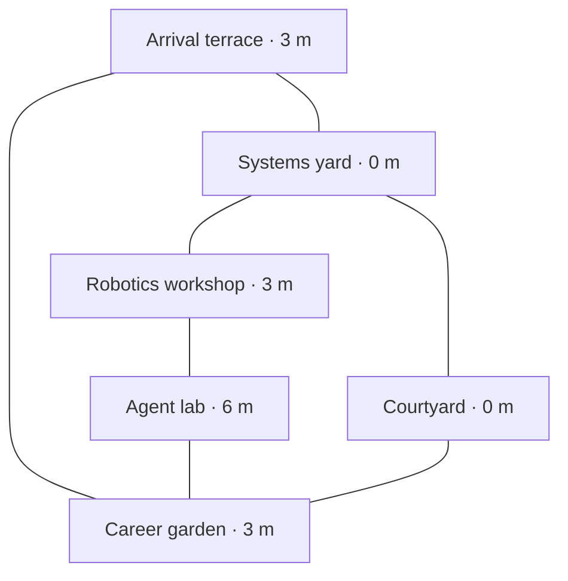

# World concept and art direction

## The scene

A small wheeled caretaker stands on a worn arrival terrace. Beyond it, workshops step down into a planted courtyard and climb again toward an engineering tower. Pipes and bridges expose the settlement's working structure. A vast, lightly visible glass dome arches over everything. Through it, a blue ocean planet hangs high above the far terraces. Daylight is soft. Tools are still out, a jacket hangs from a chair, and a distant mechanism continues its routine.

The absence of people is peaceful, not ominous. There is no catastrophe to explain and no plot to solve. The visitor is free to explore an engineer's work through the objects of this place.

## What has been superseded

The earlier asteroid workshop proposal was a useful starting idea, but the interview chose an orbital research settlement with open circulation under glass. A closed-corridor station would hide the planet and diminish the chosen terraces. An alien ruin would weaken the human, practical engineering character. Neither is a second design option to reopen during implementation.

## Composition and scale

- One Three.js unit is approximately one meter. Initial robot envelope: 0.9 m wide, 1.15 m long, 1.1 m tall including camera mast.
- Full explorable footprint: roughly 72 × 64 m. Dome radius approximately 65 m; height around 48 m. These are blockout targets, not CAD requirements.
- Main terrace heights: 0, 3, and 6 m. Main routes at least 3.5 m wide; broad ramps target 1:6 rise/run or gentler. Use switchbacks where needed. No compulsory stairs.
- Keep overhead route clearance at least 4.5 m where the robot actually passes beneath a bridge; never place a 3 m bridge over a main route simply because terrace heights use 3 m increments.
- Longest useful path target: 90 m or less. At normal speed, a purposeful visit can cross the world in about a minute. Do not make the visitor repeatedly cross empty space.
- Each sector is visible from a neighboring sector. At least two destination silhouettes are visible at arrival.
- At least two-thirds of primary traversal is open to the dome overhead. Short covered links and open-front workshops are allowed, but cannot dominate.

### Spatial arrangement

Coordinates use +Y up and −Z toward the far side of the opening view. Centers are compositional anchors; place footprints, ramps, safe spawn points, and camera anchors separately in scene data.

| Destination | Approximate center (x, y, z) | Shape / landmark | Portfolio purpose |
| --- | --- | --- | --- |
| Arrival terrace | (0, 3, 25) | Low roof canopy, station sign, broad overlook | Identity, controls, destination map, quick contact |
| Systems yard | (−20, 0, 7) | Open gantry and delivery model under a partial canopy | Featured delivery platform and backend projects |
| Robotics workshop | (−22, 3, −18) | Sawtooth workshop roof, open repair bay | Verified physical prototypes and historical tooling |
| Agent lab | (18, 6, −20) | Slender mast and open computing pavilion | Curated, clearly illustrative agent/system models |
| Career and contact garden | (24, 3, 13) | Shaded pergola, wall-mounted career panels, bench | Career, about, GitHub, LinkedIn |
| Shared courtyard | (0, 0, 0) | One distinctive tree, planted seating, service channel | Orientation and circulation, not a sixth content sector |

This is route topology, not a scale drawing. All edges are continuous traversable paths or ramps in version one. A lift may be added later as an optional shortcut, never the only way to content. Solve ramp lengths in blockout before decorating.

## Planet, sky, and dome

The planet belongs **in the sky above the settlement**, not as a floor beneath glass, a tiny distant moon, or an image inside a room. From arrival, place its center roughly 16–18 degrees above the far horizon, slightly right of the main landmark. Target a visible disc 16–20 degrees across, large enough to read as a planet with oceans and clouds. Keep it visible in the default wide camera, not only when looking straight up. Compose the camera, planet and far buildings together; a steep downward follow camera cannot show this sky view.

The dome encloses air and the ground establishes artificial gravity; do not build a simulation or explanation of orbital mechanics. Artistic composition takes priority over physically exact orbit geometry. Sky tint is a faint blue-gray atmospheric veil; avoid an opaque Earth-like sky that hides the planet. No dense daytime star field.

Use sparse structural ribs and a few restrained pane reflections to communicate the dome. Most of the glass is almost invisible. Do not make the settlement look trapped in a white fog sphere or a geodesic cage. No real-time full-screen refraction, no layered transparent panes everywhere, no dome shadow grid covering every sign. Glass is visual scenery, not a movement collider.

Planet: a distant sphere or sky-layer mesh with a stylized ocean/land texture and a separate restrained cloud treatment. It should show coherent geography, lighting, and an atmospheric edge, not a blue ball with random white dots. Slow cloud motion is optional and frozen in reduced-motion mode. Treat distant backdrop rendering/depth separately from local world collision and camera bounds.

## Visual language

| Token | Color | Use |
| --- | --- | --- |
| Structural slate | `#394B56` | Steel frames, gantries, panel edges |
| Weathered aluminum | `#B9C3C5` | Main metal surfaces, pale equipment housings |
| Chalk enamel | `#E4E9E3` | Readable sign faces and selected painted panels |
| Service orange | `#C66B3C` | Cable jackets, handles, functional markers; sparingly |
| Garden green | `#617C57` | Plants and selected workshop paint |
| Ocean blue | `#397CA5` | Planet and a few navigational accents |

Use dark charcoal text on pale signs, with measured contrast. Orange is a hardware accent, not the default text color. Colors are art targets; tune them under the actual renderer's color management and daylight.

Typography: locally hosted **IBM Plex Sans** for prose and sign headings; **IBM Plex Mono** only for equipment identifiers or genuine technical data. Include their license when acquiring font assets. Use sentence case and natural line lengths; no obligatory tracked all-caps labels. The physical framework and material make a sign futuristic, not a hard-to-read sci-fi font.

Materials are rough painted steel, dull aluminum, rubber, cable insulation, lightly scratched glass, fabric, and vegetation. Wear accumulates at edges and frequently used surfaces. Avoid uniformly applying noise to every object. Corners have intentional bevels or silhouette breaks; do not present unmodified boxes as finished machines.

Lighting: one soft directional daylight source, restrained sky fill, baked or inexpensive contact shading, warm task lights in shelter. No global bloom, lens dirt, chromatic aberration, film grain, depth of field, or constant camera sway by default. Warm task lights should not overpower daylight.

## Character

An original four-wheeled service robot with a low rectangular chassis, rubber tires, visible suspension joints, one camera mast, and a folded tool arm. Slight asymmetry: a replacement side panel, a small utility bag, mismatched repair paint. No giant cartoon eyes or brand imitation.

The body gently leans under acceleration; wheels rotate based on actual distance traveled. The mast looks toward a nearby exhibit when stationary. These motions communicate intent without intrusive idle animations. The robot is silent until the visitor enables sound. Keep the robot readable against pale floors with a slate chassis and small orange service details.

No simulated wheel drivetrain is necessary. The wheeled silhouette and grounded animation matter; vehicle physics do not. The robot turns toward movement rather than forcing tank steering.

## Objects and environmental storytelling

| Area | Signature object | Supporting objects | Quiet activity |
| --- | --- | --- | --- |
| Arrival | Physical identity sign and three-dimensional route map | Battered dock bollard, tool trolley, planted railing, direction signs | Small antenna movement or slow ventilation fan |
| Systems | Bench-scale delivery network with a robot moving between physical stops | Cable trays, server cabinets, labeled API blocks, testing bench | Pulses follow a fixed illustrative route; model robot completes a slow loop |
| Robotics | Repair bench with articulated prototype | Parts drawers, calipers, printed brackets, vise, spare wheels | One gentle mechanism demonstration; no sparks or welding spectacle |
| Agent lab | Physical job-routing sculpture | Desk consoles, relay units, short explanatory plaques | Tokens move through labeled stages; no live models or accounts |
| Career garden | Career panels integrated into a pergola wall | Mug, jacket, chessboard, plant pots, sketchbook | Leaf motion only if inexpensive and motion preferences allow |

Use 8–12 reusable prop families, placed with intention, instead of hundreds of bespoke assets. Human traces are concentrated in believable work/rest spots. Do not scatter readable fake personal correspondence or fabricate coworkers. An absent live crew is sufficient; no animated cat, crowds, or roaming NPC system in version one.

## First-frame art acceptance

At ordinary desktop width, an unprompted viewer should identify a wheeled robot, terraced research settlement, glass dome, and blue planet without moving. The owner's physical sign must be visible and comfortably inspectable. The image should feel bright, open, industrial, and cared for. If it resembles an indoor hallway, generic low-poly city, neon cyberpunk scene, or blue cube demo, revise before adding sectors.
